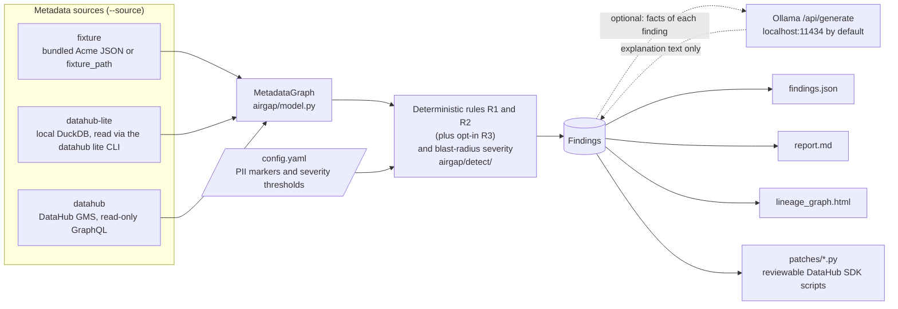

# Airgap

[](https://github.com/zelihaguven/airgap/actions/workflows/test.yml)
[](https://pypi.org/project/airgap-datahub/)
[](LICENSE)

**A local-first PII lineage auditor for [DataHub](https://datahubproject.io).**

Airgap reads your DataHub catalog (tags, glossary terms, ownership and lineage),
follows column-level lineage from classified PII columns, and reports where
that data ends up without a matching classification or without an owner.
Detection is plain, deterministic Python. An optional local model (Ollama)
only writes explanations. Your metadata is never sent to a cloud service.

Airgap is an independently maintained open source project, licensed under
Apache-2.0.

## Why

PII is usually classified correctly at the source (`users.email` is tagged
`PII`), but the classification does not follow the data through transforms,
marts, feature tables and dashboards. The result is untagged PII downstream,
derived tables with no owner, and audits that mean walking the lineage graph
by hand. Automating that audit with a hosted LLM would mean shipping your
schema and lineage to a third party, which is the kind of leak you are trying
to prevent. Airgap runs the audit on your machine instead.

## Install

```bash
pip install airgap-datahub
```

The PyPI distribution is `airgap-datahub`. The command and the import name are
both `airgap` (`python -m airgap` works too). Python 3.10 or newer is
required, and CI runs on 3.10, 3.11 and 3.12.

Optional extras:

- `pip install "airgap-datahub[datahub-lite]"` installs DataHub Lite for
  `--source datahub-lite`.
- [Ollama](https://ollama.com) running locally (`ollama pull qwen2.5:7b`) adds
  plain-language explanations to each finding. Without it, Airgap prints one
  warning and still writes the full deterministic report.

## Quickstart

The default config and a synthetic demo catalog ("Acme") ship inside the
package, so this works from any empty directory, fully offline:

```bash
airgap audit --no-llm
```

Real output from v0.1.0 (run in `/tmp/airgap-demo`):

```text
  · Config: bundled default (airgap/data/config.yaml)
  · Fetching metadata from source: fixture
  · Loaded 11 assets, 10 lineage edges, 12 column-level edges
  · Detection complete: 5 finding(s)

  Airgap — governance findings
  ----------------------------------------------
  CRITICAL AIRGAP-R1-001  Untagged PII propagation into acme.marketing.marketing_enriched  (blast radius: 1)
  CRITICAL AIRGAP-R1-003  Untagged PII propagation into acme.ml.churn_features  (blast radius: 1)
  CRITICAL AIRGAP-R2-001  Ownerless sensitive asset: acme.marketing.marketing_enriched  (blast radius: 1)
  HIGH     AIRGAP-R1-004  Untagged PII propagation into acme.analytics.user_backfill  (blast radius: 1)
  MEDIUM   AIRGAP-R1-002  Untagged PII propagation into acme.analytics.tmp_user_export  (blast radius: 0)

  → /tmp/airgap-demo/outputs/findings.json
  → /tmp/airgap-demo/outputs/report.md
  → /tmp/airgap-demo/outputs/lineage_graph.html
  → 5 remediation patch(es) in /tmp/airgap-demo/outputs/patches/
```

One finding from `outputs/findings.json`:

```json
{
  "id": "AIRGAP-R1-003",
  "rule": "R1",
  "title": "Untagged PII propagation into acme.ml.churn_features",
  "severity": "CRITICAL",
  "asset_urn": "urn:li:dataset:(urn:li:dataPlatform:feast,acme.ml.churn_features,PROD)",
  "asset_name": "acme.ml.churn_features",
  "leaked_fields": ["phone_raw"],
  "evidence": [
    "acme.public.users.phone -> acme.staging.stg_users.phone -> acme.analytics.dim_customer.phone -> acme.ml.churn_features.phone_raw"
  ],
  "blast_radius": 1,
  "consumers": {"chart": 1},
  "remediation": "Apply the PII/Sensitive classification (and matching glossary term) to field(s) phone_raw on acme.ml.churn_features, or mask/drop them before this asset. Propagate the term from the upstream classified column.",
  "explanation": ""
}
```

`explanation` is empty because the run used `--no-llm`. The files in
[`examples/`](examples) come from an earlier run against DataHub Lite with
Ollama enabled, so they include explanations (finding IDs are numbered per run
and can differ between sources).

## Usage

`audit` is the only subcommand.

```text
$ airgap --help
usage: airgap [-h] [--version] {audit} ...

Local-first data governance & PII lineage auditor for DataHub.

positional arguments:
  {audit}
    audit     Run a governance audit.

options:
  -h, --help  show this help message and exit
  --version   show program's version number and exit
```

```text
$ airgap audit --help
usage: airgap audit [-h] [--config CONFIG]
                    [--source {fixture,datahub-lite,datahub}] [--url URL]
                    [--token TOKEN] [--model MODEL] [--no-llm] [--out OUT]
                    [--format {json,md,html,sarif}]
                    [--fail-on {critical,high,medium}] [--fail-on-critical]

options:
  -h, --help            show this help message and exit
  --config CONFIG       Path to a config file (default: ./config.yaml if
                        present, otherwise the bundled default config)
  --source {fixture,datahub-lite,datahub}
                        Override source
  --url URL             DataHub URL (for --source datahub)
  --token TOKEN         DataHub access token (default: $AIRGAP_DATAHUB_TOKEN,
                        then datahub.token in the config file)
  --model MODEL         Override Ollama model
  --no-llm              Skip the local LLM layer
  --out OUT             Output directory, relative to the current directory
                        (default: ./outputs)
  --format {json,md,html,sarif}
                        Report format to write; repeat for several (default:
                        json, md and html)
  --fail-on {critical,high,medium}
                        Exit with 2 if any finding is at or above this
                        severity (CI mode)
  --fail-on-critical    Same as --fail-on critical
```

Command-line flags override the matching config values (`--source`, `--url`,
`--token`, `--model`, and `--no-llm` for `ollama.enabled`). The
`AIRGAP_DATAHUB_TOKEN` environment variable sits between them for the token:
it overrides `datahub.token` in the config file, and `--token` overrides it.
`airgap --version` prints the installed version.

### Exit codes

| Code | Meaning |
|---|---|
| `0` | Audit completed. Findings do not change the exit code unless `--fail-on` is set. |
| `1` | Airgap stopped with a one-line `airgap: error: ...` message on stderr and no traceback. Examples: the `--config` file does not exist or is not valid YAML, the config names an unknown `source`, the fixture file is missing, is not valid JSON or lacks a required key, `--out` names an existing file, `source: datahub` has no URL, DataHub answers with an HTTP error (401 and 403 add a token hint) or cannot be reached, the `datahub` executable for `source: datahub-lite` was not found, or a `datahub lite` command failed (its last stderr line is shown). |
| `2` | `--fail-on LEVEL` was set and at least one finding is at or above `LEVEL`. Invalid command-line arguments also exit with `2`. |

`--fail-on critical` fails only on CRITICAL findings, `--fail-on high` on HIGH
or CRITICAL, and `--fail-on medium` on any of the three. `--fail-on-critical`
is kept as another name for `--fail-on critical`; if both flags are given, the
last one wins. On the bundled demo, `airgap audit --no-llm --fail-on high`
exits with `2`, which is how you would gate a CI job on new leaks.

`--format` picks the report files: `json` (`findings.json`), `md`
(`report.md`), `html` (`lineage_graph.html`) and `sarif` (`findings.sarif`).
Repeat it to write several, for example
`airgap audit --no-llm --format json --format sarif`. Without `--format`,
Airgap writes `json`, `md` and `html`, as before. Remediation patches are
always written.

## Configuration

`airgap audit` picks its config in this order:

1. `--config path/to/config.yaml`, if given;
2. `config.yaml` in the current directory, if present;
3. the default config bundled with the package (the same content as
   [`config.yaml`](config.yaml) in this repo), which audits the bundled demo
   catalog.

The line `· Config: ...` in the output tells you which one was used. Copy
[`config.yaml`](config.yaml) to start your own. The keys Airgap reads:

| Key | Default | What it does |
|---|---|---|
| `source` | `fixture` | `fixture`, `datahub-lite` or `datahub`. |
| `fixture_path` | `""` | JSON catalog for `source: fixture`. Empty means the bundled Acme catalog. A relative path is resolved against the config file's directory. |
| `datahub.url`, `datahub.token` | `""` | GMS endpoint and personal access token for `source: datahub`. The `AIRGAP_DATAHUB_TOKEN` environment variable overrides `datahub.token`, and `--token` overrides both. |
| `datahub.lineage_depth` | `4` | For `source: datahub`, how many downstream hops to follow from each dataset. Dashboards, charts, data jobs and ML models reached within that many hops are loaded as assets. Values below 1 count as 1. |
| `datahub_lite.bin` | (not set) | Path to the `datahub` executable for `source: datahub-lite`. Defaults to the one next to the running Python, else `datahub` on `PATH`. |
| `ollama.url`, `ollama.model`, `ollama.timeout_seconds` | `http://localhost:11434`, `qwen2.5:7b`, `120` | Local explanation model. |
| `ollama.enabled` | `true` | Set `false` (or pass `--no-llm`) to skip explanations. |
| `detection.pii_markers` | `PII`, `Sensitive`, `Email`, ... | Tags or glossary terms that mark a field or dataset as sensitive. Matching is case-insensitive, and a dotted marker such as `Classification.Sensitive` also matches its last segment (`Sensitive`). |
| `detection.human_facing_types` | `dashboard`, `chart` | Downstream entity types that make a finding CRITICAL. |
| `detection.severity.critical_blast_radius` | `3` | Blast radius at or above which a finding is CRITICAL. |
| `detection.severity.high_blast_radius` | `1` | Blast radius at or above which a finding is HIGH. |

Outputs go to `./outputs/` in the current directory. Change that with
`--out DIR`.

## Metadata sources

All three sources produce the same normalized `MetadataGraph`
([`airgap/model.py`](airgap/model.py)), so the detection code does not know
or care where the metadata came from.

### `fixture` (default)

A JSON catalog in DataHub's shape: assets with fields, tags, glossary terms
and owners, plus dataset-level `edges` and column-level `field_edges`. The
bundled one is [`airgap/data/acme_datalake.json`](airgap/data/acme_datalake.json).

### `datahub-lite`: a real DataHub on your laptop, no Docker

[DataHub Lite](https://docs.datahub.com/docs/datahub_lite) is a DuckDB-backed
local DataHub. From a source checkout, one script installs it, converts the
Acme catalog into genuine DataHub metadata aspects, and imports them:

```bash
bash scripts/setup_datahub_lite.sh
./.venv/bin/airgap audit --source datahub-lite
```

The script creates `./.venv`, installs `.[datahub-lite]`, writes
`outputs/acme_mcps.json`, creates `~/.datahubenv` if it does not exist, and
runs `datahub lite import`. Airgap then reads every entity back through the
`datahub lite` CLI: `schemaMetadata` (field tags and glossary terms),
`globalTags`, `ownership`, `upstreamLineage` including `fineGrainedLineages`,
and `dashboardInfo` / `chartInfo`.

The whole catalog is read with one `datahub lite export` call. If that command
fails, Airgap prints a note and falls back to `datahub lite list-urns` plus one
`datahub lite get` per entity, which is much slower because each call starts a
new process. If the export succeeds but its output is not the expected list of
aspects, Airgap stops with an `airgap: error:` message instead of reporting an
empty catalog.
Airgap uses only the public `datahub` CLI, not DataHub's Python internals.

### `datahub`: a running DataHub GMS

```bash
export AIRGAP_DATAHUB_TOKEN="<your personal access token>"
airgap audit --source datahub --url https://your-datahub.example.com
```

Airgap sends read-only GraphQL queries to `<url>/api/graphql`: a dataset
search, one query per dataset for schema, tags, terms, ownership and
fine-grained lineage, and paged downstream lineage queries (200 results per
page) that start from every dataset and follow downstream entities for up to
`datahub.lineage_depth` hops. You can also put the URL and token in your
config file instead of on the command line.

The `fixture` and `datahub-lite` paths are the ones exercised end to end today.

## How detection works

| Rule | Flags |
|---|---|
| **R1: untagged PII propagation** | A sensitive field reaches, through column-level lineage, a downstream field that has no sensitive marker on a dataset that has no sensitive tag. Leaked fields are grouped into one finding per downstream dataset. |
| **R2: ownerless sensitive asset** | A dataset with no owner that either carries a sensitive marker itself or receives sensitive fields through column-level lineage. |

R1 starts from **PII origins**: sensitive fields with no sensitive upstream
field. It walks column-level lineage breadth-first from each origin and
records the path, so every R1 finding carries its evidence, for example
`acme.public.users.email -> acme.staging.stg_users.email -> acme.analytics.dim_customer.email -> acme.marketing.marketing_enriched.email`.
R2 evidence is a one-line reason. Both rules need column-level lineage to see
propagated PII. With only dataset-level lineage, R1 finds nothing and R2 only
flags datasets that are marked sensitive themselves.

**Severity** comes from the **blast radius**, the number of assets reachable
downstream of the flagged dataset through dataset-level lineage:

- **CRITICAL** if any of those assets is human-facing (`dashboard` or `chart`
  by default) or the blast radius is at least `critical_blast_radius`;
- **HIGH** if the blast radius is at least `high_blast_radius`;
- **MEDIUM** otherwise.

## Outputs

| File | Contents |
|---|---|
| `findings.json` | `{"schema_version": 1, "airgap_version": ..., "generated_at": ..., "source": ..., "findings": [...]}` with the fields shown in the Quickstart. The layout is described in [docs/DOCUMENTATION.md](docs/DOCUMENTATION.md#91-findingsjson-schema). |
| `findings.sarif` | Only with `--format sarif`. The same findings as a [SARIF 2.1.0](https://docs.oasis-open.org/sarif/sarif/v2.1.0/sarif-v2.1.0.html) log for code-scanning tools. See [docs/DOCUMENTATION.md](docs/DOCUMENTATION.md#92-sarif-output). |
| `report.md` | Markdown report: severity summary, then each finding with evidence, blast radius, remediation and explanation. |
| `lineage_graph.html` | Self-contained lineage map with leak paths drawn in red. No CDN or external assets, so it opens offline. |
| `patches/<finding-id>.py` | One remediation script per finding using the DataHub Python SDK (`acryl-datahub`): R1 adds the PII tag and `Classification.Sensitive` term to the leaked fields, R2 assigns an owner (a placeholder group you replace). Review and edit before running. Airgap never runs them and never writes to DataHub. |

## Architecture



- **Sources** ([`airgap/sources/`](airgap/sources)) each turn one kind of
  input into the shared `MetadataGraph`: assets (datasets, dashboards, charts)
  with fields, tags, glossary terms and owners, plus dataset-level and
  column-level lineage edges.
- **Model** ([`airgap/model.py`](airgap/model.py)) is the source-agnostic
  contract. Adding a source means producing this graph, nothing else.
- **Detection** ([`airgap/detect/`](airgap/detect)) applies R1 and R2 (plus
  the opt-in R3) and scores severity using only the graph and the config.
  The same input always gives the same findings, and the rules are covered
  by regression tests.
- **Explanations** ([`airgap/llm/`](airgap/llm)) are optional. For each
  finding, Airgap sends its rule, asset, leaked fields, evidence and blast
  radius to the configured Ollama endpoint and stores the reply in
  `explanation`. The model never adds, removes or rescores findings, and if
  Ollama is unreachable the run continues without it.
- **Reports and remediation** ([`airgap/report/`](airgap/report),
  [`airgap/remediate/`](airgap/remediate)) write the four outputs above.
- **CLI** ([`airgap/cli.py`](airgap/cli.py)) resolves the config, applies
  flag overrides and wires the steps together.

**Why local-first.** The metadata Airgap reads (column names, PII tags,
ownership, lineage) is itself sensitive, because it is a map of where personal
data lives. So the only network calls Airgap makes are read-only queries to
the DataHub instance you point it at and, if enabled, calls to the Ollama
endpoint in your config, which is `localhost` by default (keep it that way to
stay local). There is no telemetry and no hosted model.

## Testing

Run the test suite from a source checkout:

```bash
python3 -m venv .venv
./.venv/bin/pip install -e ".[dev]"
./.venv/bin/python -m pytest -v
```

The tests pin the expected findings on the Acme catalog
([`tests/test_detection.py`](tests/test_detection.py)) and the config and
output-directory defaults of the CLI
([`tests/test_cli_defaults.py`](tests/test_cli_defaults.py)). CI runs them on
Python 3.10, 3.11 and 3.12 on every push and pull request, followed by an
offline smoke run of `airgap audit --no-llm`.

**Scenario test report: coming soon (to be added after the current test run).**

## Contributing and roadmap

Contributions are welcome. Start with [CONTRIBUTING.md](CONTRIBUTING.md) for
the dev setup and pull request conventions. Planned work is in the
[v0.2 milestone](https://github.com/zelihaguven/airgap/milestone/1), and
issues labeled
[`good first issue`](https://github.com/zelihaguven/airgap/labels/good%20first%20issue)
are a good place to begin. Release history is in [CHANGELOG.md](CHANGELOG.md).

### What may change

Airgap started as a project for a DataHub hackathon. Its detection code
([`airgap/detect/`](airgap/detect/) and [`airgap/model.py`](airgap/model.py))
does not import DataHub or its SDK (its model only follows DataHub's URN
shape), and besides DataHub Lite and GMS it already reads a JSON catalog file
(`source: fixture`). A source-agnostic core, with DataHub as one optional
source and possibly more sources next to it, is being considered for v0.3.

## Origin

Airgap started as an entry to the DataHub Agent Hackathon in August 2026 and is
now maintained independently as an open source tool. The hackathon material is
kept for reference:


*Leak map from a local DataHub Lite run. Red paths show where PII escapes.*

- [Demo film](https://htmlpreview.github.io/?https://github.com/zelihaguven/airgap/blob/main/docs/demo_film.html) (self-playing walkthrough) and its [video script](docs/VIDEO_SCRIPT.md)
- [Interactive leak map](https://htmlpreview.github.io/?https://github.com/zelihaguven/airgap/blob/main/examples/lineage_graph.html)
- [Slide deck](https://htmlpreview.github.io/?https://github.com/zelihaguven/airgap/blob/main/docs/presentation.html)
- [Hackathon writeup](docs/DEVPOST.md)
- [Technical documentation](docs/DOCUMENTATION.md) and the original [product requirements doc](docs/PRD.md) (in Turkish)

<p align="center">
  
  
  
</p>

## License

Apache-2.0. See [LICENSE](LICENSE).
